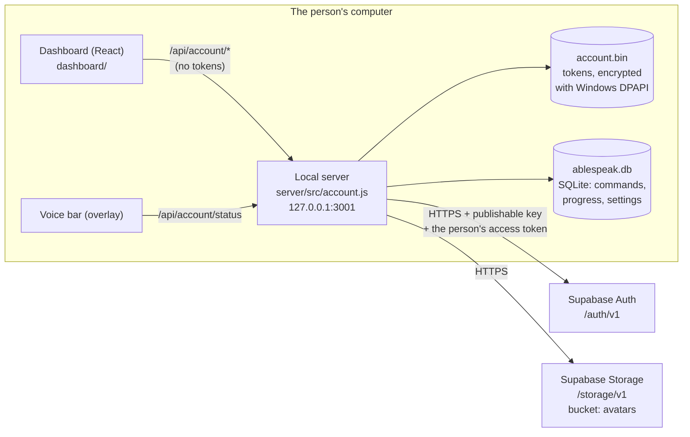
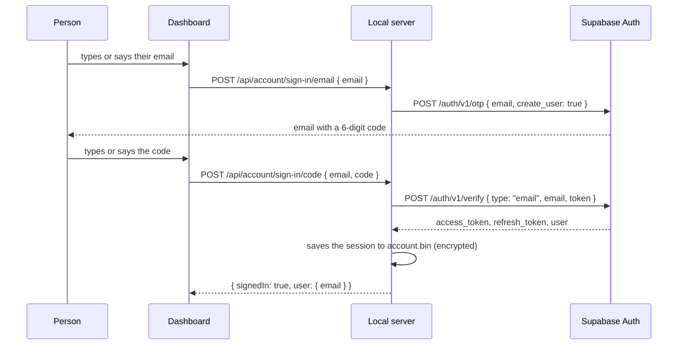

# How AbleSpeak connects to Supabase

AbleSpeak (the desktop app, "Computer control") uses Supabase for **accounts**: signing in, the person's profile, and their profile photo. Everything else (voice commands, progress, voice prints, settings) stays in a local database on the computer.

This guide explains what is stored where, how the app talks to Supabase, how to set up a Supabase project for it, and how to check that it works.

---

## Contents

1. [The short version](#1-the-short-version)
2. [What lives in Supabase, and what stays on the computer](#2-what-lives-in-supabase-and-what-stays-on-the-computer)
3. [How the connection works](#3-how-the-connection-works)
4. [Setting up a Supabase project](#4-setting-up-a-supabase-project)
5. [Connecting the app](#5-connecting-the-app)
6. [Roles: admin and helper](#6-roles-admin-and-helper)
7. [Every Supabase call the app makes](#7-every-supabase-call-the-app-makes)
8. [Security rules](#8-security-rules)
9. [Checking that it works](#9-checking-that-it-works)
10. [Troubleshooting](#10-troubleshooting)
11. [Where the code is](#11-where-the-code-is)

---

## 1. The short version

- The app talks to Supabase over **HTTPS, using Supabase's REST endpoints** (`/auth/v1/...` and `/storage/v1/...`). It does **not** use the `@supabase/supabase-js` client library, and it does **not** open a direct Postgres connection.
- It needs two settings, in `server/.env`:
  ```ini
  SUPABASE_URL=https://<project-ref>.supabase.co
  SUPABASE_PUBLISHABLE_KEY=sb_publishable_...
  ```
- **Only the publishable key** goes in the app. The secret key (`sb_secret_...`, formerly `service_role`) must never be put in `.env`, in the code, or anywhere on a user's computer.
- All Supabase traffic goes through the **local server** (`server/`, port 3001). The dashboard and the voice bar never see a Supabase token. They call the local routes under `/api/account/...`.
- Without these two settings, AbleSpeak still works fully on that one computer. The sign-in page simply isn't shown.



---

## 2. What lives in Supabase, and what stays on the computer

### In Supabase

| What | Where in Supabase | Written by |
|---|---|---|
| The account (email, sign-in method, id) | `auth.users` | Supabase Auth, at first sign-in |
| AbleSpeak role (`admin` / `helper`) | `auth.users.raw_app_meta_data → ablespeak_role` | **The project owner only**, in the SQL editor. A user can never change it |
| Profile details | `auth.users.raw_user_meta_data` (the "user metadata") | The app, for the signed-in person |
| Profile photo | Storage bucket **`avatars`**, file `<user id>/avatar` | The app, for the signed-in person |

The profile details kept in user metadata are:

| Field | Values |
|---|---|
| `full_name` | Up to 80 characters |
| `school` | School or organisation, up to 100 characters |
| `role` | `student`, `teacher`, `parent`, `helper`, `developer` (`developer` only for accounts with the admin role) |
| `age_group` | `under_13`, `13_17`, `18_plus` |
| `country` | A fixed list (Kenya, Uganda, Tanzania, …, Other) |
| `county` | One of Kenya's 47 counties (cleared if the country isn't Kenya) |
| `avatar_path`, `avatar_version` | Where the photo is, and when it last changed |
| `analytics_consent` | `{ analytics, by: "self" \| "guardian", at, version }`: the person's analytics choice. Under 18, a parent or guardian must agree |

**There are no custom tables in Supabase for this app.** The profile is stored in the user record that Supabase Auth already provides, so no `create table` or row-level security on tables is needed. The only setup SQL is for the photo bucket ([section 4.4](#44-the-profile-photo-bucket-sql-run-once)).

### On the computer only

| What | Where |
|---|---|
| Commands, progress, words learned, settings | SQLite: `server/data/ablespeak.db` in development, `%APPDATA%\AbleSpeak\data\ablespeak.db` when installed |
| The sign-in session (access and refresh tokens) | `account.bin` next to the database, **encrypted with Electron `safeStorage` (Windows DPAPI)**, so other Windows users on the same PC can't read it |
| Voice prints ("Only my voice") | `voiceprints.bin`, encrypted the same way |
| API keys, PIN hashes | `server/.env` (installed: `%APPDATA%\AbleSpeak\.env`) |

If secure storage isn't available (for example in tests or `npm start` outside Electron), the session is kept **in memory only** and lasts until the app closes. Nothing readable is written to disk.

---

## 3. How the connection works

### 3.1 Starting up

1. `electron-main.cjs` loads `server/.env` (installed: `%APPDATA%\AbleSpeak\.env`) **before** the server starts.
2. `server/src/index.js` creates the account service:
   ```js
   const account = createAccount({
     url: process.env.SUPABASE_URL,
     key: process.env.SUPABASE_PUBLISHABLE_KEY,
     store: createSecureStore(join(dirname(DB_PATH), 'account.bin')),
     ...
   });
   ```
3. `account.refresh()` runs once. If a saved session exists, it is renewed with Supabase, which also brings in any role change made since. With no internet, the saved session is kept until next time.
4. The voice bar waits until someone has signed in, or has chosen **Not now** on the sign-in page (`electron-main.cjs`, `checkOverlayAllowed`, which asks `/api/account/status`).

### 3.2 Signing in with an email code (no passwords)



The first sign-in with a new email creates the account (`create_user: true`).

### 3.3 Signing in with Google (PKCE)

1. The dashboard calls `POST /api/account/sign-in/google`.
2. The server makes a one-time secret (the PKCE *verifier*), keeps it in memory for 10 minutes, and opens the person's own browser at:
   `https://<project>.supabase.co/auth/v1/authorize?provider=google&redirect_to=http://127.0.0.1:3001/auth/callback&code_challenge=…&code_challenge_method=s256`
3. After Google, Supabase sends the browser back to `http://127.0.0.1:3001/auth/callback?code=…`.
4. The server swaps the code and its secret for a session: `POST /auth/v1/token?grant_type=pkce`. A code that arrives any other way is useless without that secret.
5. The browser shows a "You're signed in" page, and AbleSpeak comes to the front.

### 3.4 Staying signed in

- The access token lasts about an hour. Before each Supabase call, the server checks it. With less than a minute left, it renews it via `POST /auth/v1/token?grant_type=refresh_token`.
- Supabase **replaces the refresh token every time it is used**. The server therefore makes sure only one renewal runs at a time (`renew()` in `account.js`), so two pages asking at once can't sign the person out.
- If Supabase refuses the renewal (signed out elsewhere, or account deleted), the saved session is cleared and the person is asked to sign in again. If the internet is down, the session is kept.

### 3.5 The profile and photo

- **Read profile:** `GET /auth/v1/user` with the person's access token.
- **Save profile:** `PUT /auth/v1/user` with `{ data: { ...fields } }`. Only the fields listed in section 2 are accepted (`cleanProfile()` in `profile.js` checks them first).
- **Photo:** the dashboard shrinks the picture, then sends it as a data URL. The server checks the type (JPG, PNG or WebP, by its real bytes, not just its name) and size (512 KB at most), then uploads it to `avatars/<user id>/avatar`.

### 3.6 Analytics (Google Analytics 4)

The signed-in account's id is used as GA4's `user_id` **only** if the person agreed in their profile (`analyticsAllowed()` in `profile.js`): an age group must be set, and under 18 a parent or guardian must have agreed. No name, email or school is sent. See `server/src/analytics.js`.

---

## 4. Setting up a Supabase project

Do this once per Supabase project. Use a region close to the people using it. The current project is in the EU.

> **Shared project note:** the AbleSpeak Supabase project also holds the funding agent's tables, in the **`agent`** schema. This app never touches that schema, and nothing here should change it.

### 4.1 Get the URL and the publishable key

Supabase dashboard → **Project Settings → API Keys** (and **Data API** for the URL):

- **Project URL**: `https://<project-ref>.supabase.co` → `SUPABASE_URL`
- **Publishable key**: `sb_publishable_...` → `SUPABASE_PUBLISHABLE_KEY`

The older "anon" key also works in its place, but use the publishable key when the project has one. **Do not copy the secret / service_role key.**

### 4.2 Email codes

**Authentication → Sign In / Providers → Email**

1. Turn **Email** on.
2. **Authentication → Emails → Templates → Magic Link**: make sure the email shows the **code**, not only a link. It must contain `{{ .Token }}`, for example:
   ```html
   <h2>Your AbleSpeak sign-in code</h2>
   <p>Say or type this code in AbleSpeak:</p>
   <p style="font-size:28px;letter-spacing:4px"><strong>{{ .Token }}</strong></p>
   <p>It works for a few minutes. If you didn't ask for it, you can ignore this email.</p>
   ```
   Do the same for the **Confirm signup** template: when email confirmation is on, Supabase can use it for a brand-new person's first code.
3. Code length: 6 is the default. The app accepts 6 to 10 digits.
4. **For real use, set up your own email sender** (**Authentication → Emails → SMTP Settings**). Supabase's built-in sender is rate-limited to a handful of emails an hour and is meant for testing only.

### 4.3 Google sign-in (optional)

1. In **Google Cloud Console → APIs & Services → Credentials**, create an **OAuth client ID** (type *Web application*).
   - Authorised redirect URI: `https://<project-ref>.supabase.co/auth/v1/callback`
2. In Supabase: **Authentication → Sign In / Providers → Google**. Turn it on and paste the client ID and client secret.
3. **Authentication → URL Configuration → Redirect URLs**: add
   ```
   http://127.0.0.1:3001/auth/callback
   ```
   If you change `GATEWAY_PORT`, add that port's URL too. Without this entry, Supabase refuses to send the browser back to AbleSpeak.

### 4.4 The profile photo bucket (SQL, run once)

**SQL Editor → New query**, paste and run. The same text is in the code as `SUPABASE_SETUP_SQL` (`server/src/profile.js`), and the app shows it if photos aren't set up yet.

```sql
-- AbleSpeak profile photos (run once in Supabase > SQL Editor)
insert into storage.buckets (id, name, public, file_size_limit, allowed_mime_types)
values ('avatars', 'avatars', false, 524288, array['image/jpeg', 'image/png', 'image/webp'])
on conflict (id) do nothing;

create policy "AbleSpeak avatars: read own" on storage.objects for select to authenticated
  using (bucket_id = 'avatars' and (storage.foldername(name))[1] = auth.uid()::text);
create policy "AbleSpeak avatars: add own" on storage.objects for insert to authenticated
  with check (bucket_id = 'avatars' and (storage.foldername(name))[1] = auth.uid()::text);
create policy "AbleSpeak avatars: replace own" on storage.objects for update to authenticated
  using (bucket_id = 'avatars' and (storage.foldername(name))[1] = auth.uid()::text);
create policy "AbleSpeak avatars: remove own" on storage.objects for delete to authenticated
  using (bucket_id = 'avatars' and (storage.foldername(name))[1] = auth.uid()::text);
```

What this does:

- Makes a **private** bucket, `avatars` (no public links), that only takes JPG, PNG or WebP files of up to 512 KB.
- Each signed-in person can read, add, replace and remove files **only in the folder named after their own user id**. Nobody signed out can read anything.

---

## 5. Connecting the app

### In development

1. Copy `.env.example` to `server/.env` if you haven't already. `server/.env` is git-ignored.
2. Add:
   ```ini
   SUPABASE_URL=https://<project-ref>.supabase.co
   SUPABASE_PUBLISHABLE_KEY=sb_publishable_...
   ```
3. Start the app: `cd server && npm run desktop`.
4. The dashboard opens on the **Sign in** page.

### In an installed copy

Put the same two lines in `%APPDATA%\AbleSpeak\.env` and restart AbleSpeak.

### Turning accounts off

Remove or comment out the two lines. The app goes back to working on this computer only, with no sign-in page.

---

## 6. Roles: admin and helper

A role is stored in **app metadata** (`raw_app_meta_data.ablespeak_role`), which only the project owner can set. A person cannot give themselves a role by editing their profile.

| Role | Opens |
|---|---|
| `admin` | Every page without a PIN, and may choose the "Developer (AbleSpeak team)" profile role |
| `helper` | The Users page |
| *(none)* | The person's own pages. Admin pages need the admin PIN |

Give a role in **SQL Editor**:

```sql
update auth.users
set raw_app_meta_data = coalesce(raw_app_meta_data, '{}'::jsonb) || '{"ablespeak_role": "admin"}'::jsonb
where email = 'person@example.com';
```

Remove it:

```sql
update auth.users
set raw_app_meta_data = raw_app_meta_data - 'ablespeak_role'
where email = 'person@example.com';
```

The app picks the change up at its next start, or the next time the session is renewed (within an hour).

---

## 7. Every Supabase call the app makes

All of these are in `server/src/account.js`. Every one sends the `apikey: <publishable key>` header and times out after 15 seconds (20 for photos).

| Purpose | Method and path | Also sends |
|---|---|---|
| Email a sign-in code | `POST /auth/v1/otp` | `{ email, create_user: true }` |
| Check the code | `POST /auth/v1/verify` | `{ type: "email", email, token }` |
| Start Google sign-in | Browser opens `GET /auth/v1/authorize?provider=google…` | PKCE challenge |
| Finish Google sign-in | `POST /auth/v1/token?grant_type=pkce` | `{ auth_code, code_verifier }` |
| Renew the session | `POST /auth/v1/token?grant_type=refresh_token` | `{ refresh_token }` |
| Read the profile | `GET /auth/v1/user` | `Authorization: Bearer <access token>` |
| Save the profile or consent | `PUT /auth/v1/user` | `{ data: { … } }` + bearer token |
| Upload or replace the photo | `POST /storage/v1/object/avatars/<id>/avatar` | `x-upsert: true` + bearer token |
| Show the photo | `GET /storage/v1/object/authenticated/avatars/<id>/avatar` | bearer token |
| Remove the photo | `DELETE /storage/v1/object/avatars/<id>/avatar` | bearer token |
| Sign out | `POST /auth/v1/logout` | bearer token |

### The local routes the dashboard uses

These are on `http://127.0.0.1:3001` and are open **only to AbleSpeak's own pages on this computer** (`localOnly` + `fromOwnPages`). A website open in Chrome can't use them.

| Route | Does |
|---|---|
| `GET /api/account/status` | `{ configured, signedIn, skipped, user: { email, role, name, photo, consentAsked } }` (never tokens) |
| `POST /api/account/sign-in/email` | Sends a code |
| `POST /api/account/sign-in/code` | Checks the code |
| `POST /api/account/sign-in/google` | Opens Google in the browser |
| `GET /auth/callback` | Where the browser comes back after Google |
| `GET` / `PUT /api/account/profile` | Read or save profile details |
| `PUT /api/account/consent` | Save the analytics choice |
| `GET` / `PUT` / `DELETE /api/account/photo` | Show, change or remove the photo |
| `POST /api/account/not-now` | Carry on without an account until the app next starts |
| `POST /api/account/sign-out` | Sign out here and at Supabase |

---

## 8. Security rules

These are deliberate. Keep them when changing the code.

1. **Publishable key only.** It is designed to ship inside apps. The secret key bypasses every security rule and must never reach a user's computer.
2. **Tokens never leave the local server.** They are not sent to the dashboard, written to `.env`, or logged.
3. **Tokens are encrypted at rest** with Windows DPAPI (`safeStorage`). Without it, they stay in memory only.
4. **Roles live in app metadata**, which users can't write. Never read a role from user metadata.
5. **Account routes accept only AbleSpeak's own pages** on this computer. The server allows any origin for other reasons, so this check matters.
6. **Google sign-in uses PKCE.** The secret is made and kept on the computer, works once, and expires after 10 minutes.
7. **Photos are private** and limited to each person's own folder by Storage policies, not only by the app.
8. **Profile input is checked on the server** (`cleanProfile`, `cleanConsent`, `photoFromDataUrl`) before anything is sent to Supabase.
9. **Under-18 analytics needs a parent or guardian's agreement** (Kenya Data Protection Act 2019, s. 33).

---

## 9. Checking that it works

### Automated tests

The Supabase code is tested with a fake `fetch`, so no internet or real project is needed:

```bash
cd server
node --test src/account.test.mjs src/profile-analytics.test.mjs
```

### By hand, against a real project

1. Start the app (`npm run desktop`) with the two settings in `.env`.
2. Open `http://127.0.0.1:3001/api/account/status` in the AbleSpeak window. It should show `"configured": true`.
3. Sign in with an email. The code arrives, and after entering it the dashboard shows your email.
4. In Supabase → **Authentication → Users**, the new user is listed.
5. Open **Profile**, set a name and a photo, and save. In Supabase → **Storage → avatars**, a folder named after your user id holds `avatar`.
6. Close and reopen AbleSpeak. You are still signed in (the log shows `[Account] Session renewed`).
7. Sign out. You go back to the sign-in page, and `account.bin` is deleted.

Useful log lines (the terminal running `npm run desktop`):

| Line | Means |
|---|---|
| `[Account] No saved sign-in on this computer` | Configured, nobody signed in yet |
| `[Account] Session renewed (admin)` | Signed in; the role in brackets, if any |
| `[Account] Signed in` / `Signed in with Google` | Sign-in finished |
| `[Account] Supabase refused to renew the sign-in (…) — signed out` | Session ended elsewhere |
| `[Account] Secure storage unavailable — …` | Not in Electron; the sign-in lasts until the app closes |
| `[Electron] Overlay waits for sign-in` | The voice bar appears after sign-in or **Not now** |

---

## 10. Troubleshooting

| What you see | Likely cause | Fix |
|---|---|---|
| No sign-in page at all | `SUPABASE_URL` or `SUPABASE_PUBLISHABLE_KEY` missing | Add both to `.env`, then restart |
| "Sign-in isn't set up on this computer yet." | Same as above | Same as above |
| The email has a link but no code | The email template has no `{{ .Token }}` | Edit the Magic Link and Confirm signup templates ([4.2](#42-email-codes)) |
| "Too many codes were asked for." | Supabase's rate limit (strict with the built-in sender) | Wait a minute; set up your own SMTP for real use |
| "That code didn't work, or it has expired." | Wrong, old or already-used code | Ask for a new code |
| Google opens, then shows a Supabase error about the redirect | `http://127.0.0.1:3001/auth/callback` isn't in Redirect URLs | Add it ([4.3](#43-google-sign-in-optional)) |
| "This sign-in has expired or wasn't started from AbleSpeak." | More than 10 minutes passed, or the app restarted in between | Start Google sign-in again from AbleSpeak |
| "Profile photos aren't set up in your AbleSpeak Supabase project yet." | The `avatars` bucket or its policies are missing | Run the SQL in [4.4](#44-the-profile-photo-bucket-sql-run-once) |
| Role not taking effect | The session hasn't been renewed yet | Restart AbleSpeak, or sign out and in |
| "AbleSpeak couldn't reach the sign-in service." | No internet, or the URL is wrong | Check the connection and `SUPABASE_URL` (no trailing path) |
| Signed out after every restart | Secure storage unavailable (not running in Electron) | Start with `npm run desktop`, not `npm start` |

---

## 11. Where the code is

| File | What it does |
|---|---|
| [`server/src/account.js`](server/src/account.js) | All Supabase calls, the encrypted session store, the local `/api/account` routes and `/auth/callback` |
| [`server/src/profile.js`](server/src/profile.js) | Profile fields and checks, analytics consent rules, photo checks, the setup SQL (`SUPABASE_SETUP_SQL`) |
| [`server/src/analytics.js`](server/src/analytics.js) | GA4 events, sent only with consent, using the account id |
| [`server/src/admin-pin.js`](server/src/admin-pin.js) | Uses the Supabase role (`admin` / `helper`) to open pages without a PIN |
| [`server/src/index.js`](server/src/index.js) | Creates the account service from `.env` and mounts its routes |
| [`server/electron-main.cjs`](server/electron-main.cjs) | Loads `.env`; holds back the voice bar until sign-in or **Not now** |
| [`dashboard/src/pages/SignIn.jsx`](dashboard/src/pages/SignIn.jsx) | The sign-in page (email code and Google) |
| [`dashboard/src/pages/Profile.jsx`](dashboard/src/pages/Profile.jsx) | The profile page (details, photo, analytics choice) |
| [`dashboard/src/lib/signInFirst.js`](dashboard/src/lib/signInFirst.js) | Sends people to the sign-in page until they sign in or choose **Not now** |
| [`server/src/account.test.mjs`](server/src/account.test.mjs), [`server/src/profile-analytics.test.mjs`](server/src/profile-analytics.test.mjs) | Tests, with a fake Supabase |
| [`docs/AbleSpeak-Tier2-Phase2-Accounts-Plan.md`](docs/AbleSpeak-Tier2-Phase2-Accounts-Plan.md) | The original accounts plan (some parts, such as cloud tables for progress, are not built yet) |
