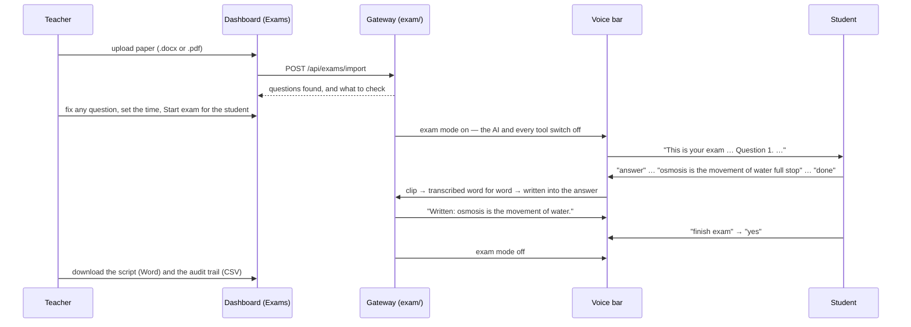

# AbleSpeak exam mode

*How a blind or motor-impaired student sits an exam by voice with AbleSpeak Tier 2, as built on 13 October 2026. For engineers, co-founders and partners such as KISE. Code: `server/src/exam/`, `dashboard/src/pages/Exams.jsx`, `dashboard/src/pages/ExamScreen.jsx`.*

A teacher uploads the exam paper. AbleSpeak reads each question aloud, the student answers by speaking, and AbleSpeak writes the answers down exactly as said. Afterwards the teacher downloads the completed script as a Word document, ready for marking, with an audit trail of everything that happened.

---

## 1. A sitting, step by step

1. **Add the paper.** The teacher saves it into the **exam folder**, `Documents\AbleSpeak Exams`, and it appears on the **Exams** page by itself (`exam-folder.js`); or uploads it on that page (helper or admin tier).
   - A paper from the folder is marked "check its questions" and cannot be started until a teacher has opened it and saved.
   - A file is read once per version of its contents. Saved again, it replaces its exam if nobody has changed or sat it; otherwise it comes in beside it. A deleted exam does not come back while the file is unchanged.
   - Files that cannot be read are listed on the page with what to do.
   - Either way, `paper-import.js` reads it on this computer and keeps Word's own list numbering ("1.", "(a)", "A."), tables and equations. `paper-parse.js` then finds sections, numbered questions, parts and sub-parts ("(a)", "(i)"), multiple-choice options and marks.
   - A scanned PDF, an old `.doc`, or a locked PDF is refused, with what to upload instead.
2. **Check.** The teacher sees exactly what will be read and can fix any question, its options or marks, and the instructions. AbleSpeak lists what to check: pictures it cannot read, questions with one option, no questions found.
   - Pictures and diagrams must be described in words, or a human reader arranged.
3. **Start.** The teacher picks the student and presses **Start exam**. Only one exam runs on a computer at a time. The dashboard switches to the large-print **exam screen**.
4. **The sitting.** Everything the student says goes to the exam and nowhere else (section 2).
5. **The end.** The exam ends when the student says "finish exam" and confirms, when the time runs out, or when the invigilator presses **End exam**.
6. **Download.** Under **Sittings and scripts**, **Script (Word)** gives a cover page with the candidate, times, how the exam ended, answers given and the integrity check, a statement of how the script was produced, and an invigilator signature line. It then lists every question with the answer exactly as written. **Audit trail** gives the CSV.

## 2. What the student can say

Commands are a fixed list (`exam-runner.js`). Nothing a student says is sent to the AI, and anything that is not a command is never written into an answer by accident.

| To… | Say |
|---|---|
| Hear the question again | "read the question", "repeat", "pardon" |
| Hear the choices | "read the options", "read option B" |
| Move | "next", "previous", "go to question 5", "go to question 2 b", "first / last question" |
| Choose an option | "answer B", "option C", or just "B" ("bee", "dee" work too) |
| Write an answer | "answer", then speak; everything said is written until "done" (or "my answer is …" in one go) |
| Punctuate | "full stop", "comma", "question mark", "new line", "new paragraph", "open/close bracket" |
| Fix it | "delete the last word", "delete the last sentence", "undo", "clear my answer" (asks first) |
| Check it | "read my answer", "read the last sentence", "spell my answer", "spell the last word" |
| Spell a word | "spell m i t o c h o n d r i a" writes it letter by letter |
| Maths | "maths on": "x squared plus three equals twelve" → `x² + 3 = 12`; "maths off" |
| Reading speed | "slower", "faster", "normal speed" (four speeds) |
| Where am I | "where am I", "how much time is left", "unanswered questions", "how many questions", "read the instructions", "help" |
| Stop the reading | "stop", "quiet" |
| Finish | "finish exam" → "yes" (only a plain yes; "okay, wait…" carries on) |

- **While answering**, one word on its own is always written ("Time", "Help" can be answers); commands then take more than one word ("how much time is left", "read my answer"). "Period", "colon" and "hyphen" become marks only when said on their own.
- **Sections that number from 1 again** become A1, A2, B1… ("go to question B 1"). Skipped or odd numbering is listed for the teacher to check.
- **Read-back** (on by default, set per exam): after each piece of an answer, AbleSpeak says "Written: …", so a blind student knows what went down.
- **Time warnings** at 30, 15, 5 and 1 minutes left. The invigilator can pause, which stops the clock. A sitting interrupted by a crash or restart can be carried on from the Exams page, and the time the app was closed is not counted.
- **Large-print exam screen** (`/exam`): the question, the answer as it is written, what AbleSpeak is waiting for, the clock, text size controls, and the invigilator's **Pause / Carry on / End exam**.

## 3. What makes it fit for an exam

- **No AI help.** While an exam runs, `aiEngine.processChat`, `aiEngine.complete` (the task agent) and `toolRegistry.executeTool` refuse everything (`examLock`). Starting an exam stops any task still running and clears a waiting yes/no question, dictation and sleep. `ws-proxy.js` sends every clip to the exam before any other handling: no AI, no quick commands, no agent, no shortcuts. Text typed on other dashboard pages is refused.
- **Verbatim answers.** Transcription uses an exam prompt: exact words, no grammar fixes, no completing sentences, never answering a question it hears. The only changes AbleSpeak makes are:
  - spoken punctuation becomes marks;
  - spoken maths becomes symbols, in maths mode;
  - a capital letter at the start of a sentence.
- **Nothing dropped quietly.** The phrase filters used outside exams (for example "I don't know what to say") are off. A clip that cannot be made out is answered with "I did not catch that clearly. Please say it again." Losing the internet is said out loud, and the answers so far are kept.
- **Saved at every step.** The answers are written to the database file after every change, not on the usual 2-second timer, and every 30 seconds while nothing is said. A sitting carried on after a crash restores the question, whether the student was answering, and an invigilator's pause.
- **Each sitting keeps its own copy of the paper**, so a later change to the exam cannot move an answer under a different question.
- **Audit trail.** Every event is stored in `exam_events`: what was heard, then what it did and what was written, and everything said, each with its time and question. Each row's SHA-256 hash covers the row before it, so a changed row is detected; when the sitting ends its length and last hash are kept with it, so rows cut from the end are detected too. (The hash is not keyed: someone able to rewrite the whole database could rebuild it.) Every script states whether the check passed.
- **Access.** Uploading, starting, pausing, ending and downloading need the helper or admin tier. The live state is only for AbleSpeak's own pages. Deleting a student deletes their sittings and audit trails.

## 4. What leaves the computer

| What | Where to | Why |
|---|---|---|
| The student's voice clips | Google Gemini (online) | transcription — the founders' choice for now (13 Oct 2026) |
| What AbleSpeak says (questions, read-backs) | Microsoft Edge TTS (online); Windows' own voice if offline | reading aloud |
| The paper, answers, scripts, audit trail | nowhere — they stay in `ablespeak.db` on this computer | |

## 5. Before this is used for a real exam

**What exam bodies require**, from research on 13 October 2026:
- **KNEC** registers special-needs candidates with a head-teacher letter, a medical report and an EARC (Educational Assessment and Resource Centre) functional assessment. It has introduced Orbit Readers (braille plus text-to-speech). It is "considering" voice-assisted formats for computer-based exams from 2027. It has published no rule yet on speech-to-text or computer readers.
- Mature rules exist elsewhere: the UK JCQ (Joint Council for Qualifications) and the US College Board. Their main conditions are:
  - software may read the paper but must not interpret it;
  - dictation is allowed where a scribe would be;
  - spelling, grammar and prediction aids are off;
  - no internet, and no AI that could help;
  - the tool must be the candidate's normal way of working, practised before the exam;
  - the centre keeps records.

How AbleSpeak stands against these:

| Requirement | Today |
|---|---|
| Reads without interpreting | Met: questions are read as written; nothing is summarised |
| No help from AI or other software | Met in software: the AI and tools are locked; transcription is word-for-word |
| No internet | **Not met**: transcription needs Gemini online, and audio leaves the computer (and Kenya) |
| Normal way of working | Needs practice exams in class; the same mode can be used for mock tests now |
| Records | Met: audit trail, script cover page, invigilator signature line |
| Data protection (Kenya Data Protection Act 2019) | **Open**: children's voice data is sensitive. Sending it abroad needs parental consent and a data protection impact assessment (DPIA), and may need ODPC (Office of the Data Protection Commissioner) approval |

**Next steps:**
1. **Offline speech recognition** before any formal exam: local Whisper, so no audio leaves the computer and no internet is needed. The exam code only calls `voiceHandler.transcribe(…, { exam: true })`, so the recogniser can be swapped there.
2. **Pilot with KISE:** mock exams with blind and motor-impaired students, measuring:
   - words written correctly (word error rate against a human transcript of the recording);
   - commands understood the first time;
   - questions where a human had to step in;
   - the students' own view.
3. **Talk to KNEC** about the 2027 computer-based exams: show the audit trail and the locked mode, and ask what approval would need.
4. **Lock the computer during exams:** run in kiosk mode, or alongside Safe Exam Browser or Windows' "Take a Test", so nothing else on the computer can be reached.
5. **Maths and diagrams:** spoken maths covers common forms only; it needs testing with maths teachers. Diagrams still need a human describer or alt text.
6. **Severe dysarthria:** recognition is still poor (over 49% word errors in 2025 benchmarks), so a human scribe stays the fallback for these students.

## 6. Where things are

| To change… | Look in |
|---|---|
| Reading Word and PDF papers | `server/src/exam/paper-import.js` |
| The exam folder (papers read by themselves) | `server/src/exam/exam-folder.js` |
| Finding questions, parts, options, marks | `server/src/exam/paper-parse.js` |
| The spoken commands and what is said | `server/src/exam/exam-runner.js` |
| Punctuation, maths, spelling, edits | `server/src/exam/spoken-text.js` |
| A sitting: saving, timer, pause, resume | `server/src/exam/exam-session.js` |
| HTTP routes (`/api/exams`) | `server/src/exam/exam-routes.js` |
| The Word script and audit CSV | `server/src/exam/exam-export.js` |
| Tables and the hash chain | `server/src/db.js` (exams, exam_attempts, exam_events) |
| Voice routing during an exam | `server/src/ws-proxy.js` (`_examVoice`) |
| Word-for-word transcription | `server/src/voice-handler.js` (`EXAM_PROMPT`) |
| Reading speed, long questions | `server/electron-main.cjs` (`speak-text`, `speechPieces`), `server/overlay.html` (`exam_*` messages) |
| Teacher page / exam screen | `dashboard/src/pages/Exams.jsx`, `dashboard/src/pages/ExamScreen.jsx` |

**Tests:** `cd server && node --test "src/exam/*.test.mjs"` runs 72 tests; `exam-review.test.mjs` keeps fixed the problems found in the code review of 13 October 2026. They cover Word and PDF import, parsing, the commands, editing, time and pause, resume after restart, the AI and tool lock, the Word script, and detection of a tampered audit row.
